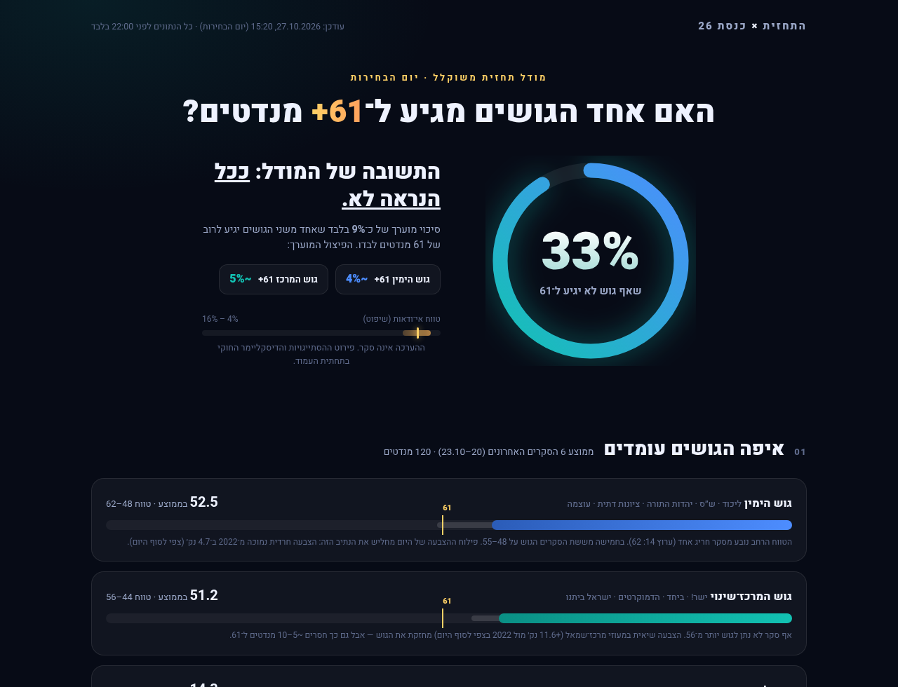

# התחזית × כנסת 26

**האם אחד הגושים מגיע ל־61+ מנדטים? התשובה של המודל: ככל הנראה לא — סיכוי מוערך של כ־9% (טווח אי־ודאות 4–16%).**

מודל תחזית משוקלל לבחירות לכנסת ה־26, שנבנה ביום הבחירות (27.10.2026) אך ורק מנתונים שפורסמו לפני 22:00. כל פרמטר מקבל משקל גלוי, כל מספר מקושר למקור, וכל שיפוט מסומן כשיפוט.

> ⚠️ **זהו לא סקר בחירות.** הפרויקט אינו מבוסס על שיטות סטטיסטיות מוכרות לעריכת סקרים, ולפיכך **אי אפשר להסיק ממנו מסקנות לגבי דפוסי הצבעה או עמדות של הציבור** (סעיף 16ה(ד) לחוק הבחירות (דרכי תעמולה), תשי״ט־1959). פירוט מלא בסעיף הדיסקליימר למטה.

## הקבצים

| קובץ | מה בו |
|---|---|
| [`index.html`](index.html) | העמוד הראשי — התחזית המלאה בעיצוב (RTL, עובד גם בנייד). פותחים בדפדפן וזהו, בלי בילד. |
| [`data/inputs.json`](data/inputs.json) | כל קלטי המודל בפורמט מובנה — לעדכון מהיר אחרי 22:00. |

## התחזית בנקודות

- **~91% שאף גוש לא מגיע ל־61+** (פיצול: ימין ~4%, מרכז ~5%)
- ממוצע 6 הסקרים האחרונים: ימין 52.5, מרכז 51.2, ערביות 14.3 — אף גוש לא קרוב ל־61
- שוק ״רוב קואליציוני״ ב־Polymarket: **7.5%** בלבד (״כנסת תקועה״: 34%)
- פילוח הצבעה מגזרי (צהריים): מעוזי מרכז־שמאל **+11.6** מול 2022, חרדים **−4.7** — נגד נתיב ה־61 של הימין

## המודל — פרמטרים ומשקלים

| פרמטר | משקל | הערכת 61+ | למה המשקל |
|---|---|---|---|
| סקרי הערוצים (6, 20–23.10) | 28% | 10% (שיפוט) | הבסיס הסטטיסטי היציב היחיד; פער של 8–10 מנדטים גדול על טעות דגימה, אבל נדנדות מאוחרות קרו בעבר |
| שוק ״רוב קואליציוני״ (Polymarket) | 20% | חי (נתון) | מתמחר בדיוק את השאלה; שוק דליל, לכן מוגבל ל־20% |
| שוק רה״מ + מפלגה מנצחת (Polymarket) | 12% | 12% (שיפוט) | נזיל (~$3.5M/24ש׳) אבל עקיף לשאלת המנדטים |
| אחוזי הצבעה + פילוח מגזרי (ועדת הבחירות / Votes26) | 18% | חי (שיפוט על נתון) | הנתון הרשמי היחיד מיום הבחירות; הכיוון המגזרי פועל בעיקר נגד רוב ימין |
| אחוז הצבעה במגזר הערבי (ועדת הבחירות / Votes26) | 10% | חי (שיפוט על נתון) | מעקב ייעודי: עלייה ערבית מחזקת את הרשימות הערביות ומרחיקה את הימין מ־61 |
| איתותים משלימים (Kalshi, טרנדס, מט״ח, ״כנסת תקועה״) | 12% | 10% (נייטרלי) | בקרת שפיות מול סטיות, לא אות עצמאי |
| **משוקלל** | 100% | **חי בעמוד** | |

המפרט המלא של המודל (נוסחאות, כללים, הנחות, חולשות): [MODEL.md](MODEL.md)

## מקורות הנתונים

- **סקרים (20–23.10, מסומנים כלא עדכניים):** [חדשות 12](https://www.mako.co.il/news-israel-elections/2026/Article-8ea5e45ec2961a1027.htm) · [חדשות 13](https://13tv.co.il/item/news/politics/politics/survey-905415900/) · [ערוץ 14](https://www.c14.co.il/article/1750553) · [כאן 11](https://www.kan.org.il/content/kan-news/politic/1112122/) · [i24NEWS](https://www.i24news.tv/he/news/israel-elections-2026/polls/artc-07d162ea) · [וואלה](https://www.walla.co.il/news/politics/383958175)
- **שוקי הימורים:** [Polymarket — ראש הממשלה הבא](https://polymarket.com/event/who-will-be-the-next-prime-minister-of-israel-after-the-next-election) (API ציבורי), Kalshi (API ציבורי)
- **אחוזי הצבעה:** ועדת הבחירות המרכזית (דרך כלי התקשורת) + פילוח מגזרי של [Votes26](https://votes26.com/?v=turnout) (עמוד ההצבעה בלבד)
- **איתותים:** Google Trends RSS (ישראל), שער שקל/דולר

## דיסקליימר חוקי (חובה)

- **זהו לא סקר בחירות** ואינו מבוסס על שיטות סטטיסטיות מוכרות; **אי אפשר להסיק ממנו מסקנות לגבי דפוסי הצבעה או עמדות של הציבור** (סעיף 16ה(ד) לחוק הבחירות (דרכי תעמולה), תשי״ט־1959).
- **הסקרים המוצגים אינם עדכניים** (פורסמו ב־20–23.10.2026) — **אין ללמוד מהם על דפוסי הצבעה או עמדות של הציבור במועד פרסום זה** (סעיף 16ה(ח) לחוק).
- **נתוני אתרי ההימורים (Polymarket/Kalshi) אינם סקר** ואינם מבוססים על שיטות סטטיסטיות מוכרות; לא ניתן להסיק מהם מסקנות על עמדות הציבור או דפוסי ההצבעה — לפי [הנחיית ועדת הבחירות המרכזית, 20.10.2026](https://www.israelhayom.co.il/news/law/article/21667242).
- **זו לא תעמולת בחירות** — אין כאן קריאה להצביע או להימנע מהצבעה.
- **לא ייעוץ פיננסי ולא המלצת הימורים.** מודל לניתוח ובידור בלבד. שוקי הימורים דלילים ועשויים לשקף סוחר בודד.
- מקורות החוק: [תמצית חוקי הבחירות (gov.il)](https://www.gov.il/apps/elections/heb/law/LawsSummary.html) · [חוק הבחירות (דרכי תעמולה) (תיקון 23), 2007](https://fs.knesset.gov.il/17/law/17_lsr_300632.pdf)

## עדכון

גרסה 1.0 נבנתה לפני 22:00 (איסור חוקי על פרסום מדגמים עד סגירת הקלפיות). התחזית תעודכן עם מדגמי הערוצים (22:00) ועם תוצאות האמת, עם חותמת זמן לכל גרסה — דרך `data/inputs.json`.
